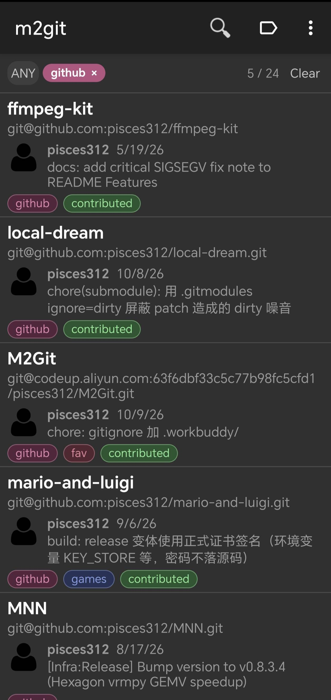
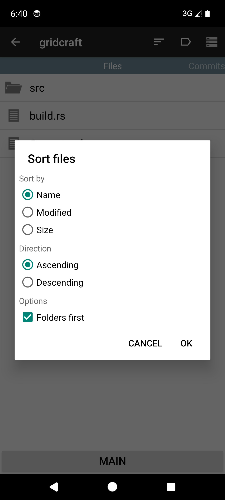
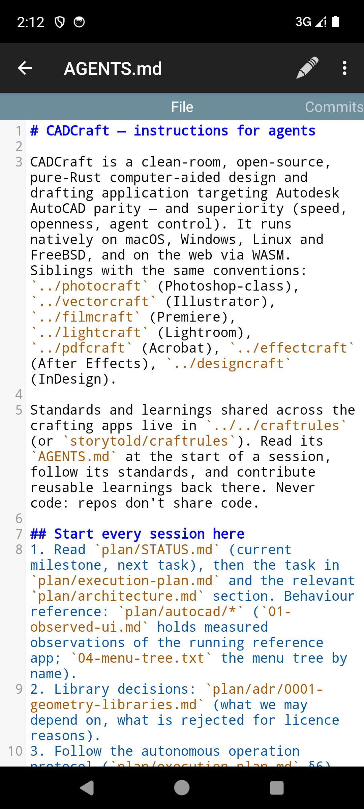

# M2Git

[中文](#中文) | [English](#english)

M2Git 是一款 Git 客户端安卓应用（Android 12+）。本仓库是基于 [Zacharia2/M2Git](https://github.com/Zacharia2/M2Git) 的自用 fork，在其之上持续做隐私加固、瘦身与功能迭代（当前版本 1.8.10）。

---

## 中文

### 功能概览

常用 Git 操作一应俱全：拉取、推送、提交、合并、克隆、比较、衍合、择取、创建/删除分支、重置更改、添加本地仓库、双向同步（Sync）、撤销提交、多账号凭证管理（SSH / Token）、浅克隆深度选项。

用 M2Git + Gitee/GitHub 同步 Obsidian、Logseq 等笔记库非常迅速，且自带历史版本，可随时回滚查看。

### 本 fork 的主要改动（相对上游 v1.8.4）

**隐私与瘦身**

- 移除 ACRA 崩溃上报与所有敏感信息日志
- 关闭系统 Auto Backup：仓库密码与 Token 不再被系统云备份 / 换机迁移带走（应用自带的加密导出导入不受影响）
- APK 体积从 35.8 MB 瘦身到约 12 MB
- 移除内置 WebDAV 服务器功能（攻击面大，不再提供）

**新功能**

- **仓库标签体系**：仓库列表平铺展示，条目底部显示标签；顶部常驻标签筛选条，支持「全部满足 / 任一满足」；点条目里的标签即筛选；详情页工具栏一键编辑标签
- **列表搜索重做**：忽略大小写的归一化子串匹配，覆盖显示名、本地路径、远程地址、提交者与提交信息，不再受 SQL 通配符干扰，非 ASCII 文本正常匹配
- **文件页排序**：名称 / 修改时间 / 大小，升序 / 降序，目录优先；与仓库列表共用同一排序面板，选择按仓库持久保存
- **状态页变更文件列表**：上半部原始 `git status` 输出，下半部带状态徽标的扁平文件列表，分割条可拖动，长按文件直接看 diff
- **提交历史滚动分页**：首屏 100 条，滚到底自动续取；搜索前先补齐全部历史
- **加密备份 / 恢复**：设置、仓库与凭据经 SAF + PBKDF2(65536) + AES/GCM 加密导出
- **仓库桌面快捷方式**、Markdown 打开模式设置、长按文件菜单「复制路径 / 复制文件名」
- **代码浏览现代化**：jQuery 3.7.1 slim / CodeMirror 5.65.21（按语言切包）/ highlight.js 11.11.2，代码高亮与 diff 渲染全面换代，清除旧版已知 CVE
- 设置页显示构建溯源（commit / 构建时间 / JGit 与 JSch 版本）；应用内语言切换改用 per-app locale（Android 13+）

**底层升级**

- JGit 7.8.0、JSch 2.28.7（mwiede fork）
- 构建栈 AGP 9.4.0 / Gradle 9.6.1，minSdk 31
- 文件页列目录移出主线程，大目录不卡界面

### 下载与安装

从 [Releases](https://github.com/pisces312/M2Git/releases) 下载签名 APK。注意：

- **仅含 arm64-v8a**（64 位 ARM 设备；模拟器可经 ARM 转译运行）
- **签名与上游 Zacharia2/M2Git 官方版不同**：装过上游版的设备必须先卸载，才能安装本 fork 的包；本 fork 的 v1.8.5 及之后版本之间可直接覆盖升级
- LFS 仅支持本地仓库配置（`lfs install`），**暂不支持克隆 / 拉取 LFS 对象**

### 界面预览

| 标签筛选 | 文件页排序 | 代码文件高亮 |
| :---: | :---: | :---: |
|  |  |  |

### 快速开始：多远程同步笔记库

国内推荐使用 Gitee 作为同步用的默认远程仓库，GitHub 作为工作和备份用的远程仓库，桌面端可定时用 `git remote add` 添加多远程后手动同步。移动端只使用默认的 Gitee 远程：

1. 安装并打开 M2Git，进入设置，配置 Git 用户名和用户邮箱
2. 若仓库是私有的，配置 Token 账户和 Token 秘钥（Gitee：`用户头像 → 设置 → 令牌`，生成专用令牌）
3. 点击导航栏最右侧菜单 → 克隆，填入克隆地址；也可以选择导入（导入时可勾选「导入为外部仓库」。外部仓库与内部仓库的区别在于是否存储在应用私有目录中）
4. 在仓库列表点击仓库进入详情页，左右滑动切换「文件 / 提交 / 状态」三个页面
5. 日常同步：详情页导航栏最右侧菜单 → 同步，按同步策略一键完成

### 克隆远程仓库

1. 点击 `+` 图标添加新仓库
2. 输入远程 URL（见下面的 URL 格式）
3. 输入本地仓库名称 —— 注意这**不是**完整路径，所有仓库存储在同一个本地目录中（可在设置中更改）
4. 点击 `Clone`，如需要会提示输入凭据，随后仓库（所有分支）会下载到设备上

### 创建本地仓库

1. 点击 `+` 图标添加新仓库
2. 点击 `Init Local` 创建本地仓库
3. 输入仓库名称，即创建一个本地空仓库

### URL 格式

**SSH**

- 标准端口（22）：`ssh://username@server_name/path/to/repo`
- 非标准端口：`ssh://username@server_name:port/path/to/repo`
- 需要填写 `username`，默认情况下会尝试以 root 身份连接

**HTTP(S)**

- `https://server_name/path/to/repo`

### 反馈

遇到问题或有建议，欢迎在本仓库的 [Issues](https://github.com/pisces312/M2Git/issues) 反馈（应用内「设置 → 关于 → 反馈」同样指向这里）。

---

## English

### Overview

M2Git is a Git client for Android (Android 12+). This repository is a personal fork of [Zacharia2/M2Git](https://github.com/Zacharia2/M2Git), continuously hardened for privacy, slimmed down, and extended with new features (current version: 1.8.10).

It covers the everyday Git workflow: pull, push, commit, merge, clone, diff, rebase, cherry-pick, branch creation/deletion, reset, adding local repositories, two-way sync, undo commit, multi-account credentials (SSH / Token), and shallow clone depth.

M2Git + Gitee/GitHub is a fast way to sync note vaults such as Obsidian or Logseq, with full history available for rollback at any time.

### What this fork changes (vs upstream v1.8.4)

**Privacy & size**

- Removed the ACRA crash reporter and all sensitive-info logging
- Disabled system Auto Backup: repository passwords and tokens are no longer carried off by cloud backup / device migration (the app's own encrypted export/import is unaffected)
- APK slimmed from 35.8 MB to ~12 MB
- Removed the built-in WebDAV server feature (large attack surface, no longer offered)

**Features**

- **Repository tags**: flat repository list with tags shown under each entry; a persistent tag filter bar at the top with "match all / match any" modes; tap a tag on an entry to filter by it; one-tap tag editing from the detail-page toolbar
- **Reworked list search**: case-insensitive, normalized substring matching across display name, local path, remote URL, committer and commit message; no more SQL wildcard interference; non-ASCII text matches correctly
- **Sortable file list**: by name / modified time / size, ascending or descending, with a folders-first toggle; shares the same sort panel as the repository list, persisted per repository
- **Status page change list**: raw `git status` output on top, a flat file list with status badges below, draggable splitter, long-press a file to view its diff
- **Paged commit history**: first 100 commits load initially, more are fetched automatically on scroll; search backfills the full history first
- **Encrypted backup / restore**: settings, repositories and credentials exported via SAF + PBKDF2(65536) + AES/GCM
- **Desktop shortcuts per repository**, Markdown open-mode setting, "copy path / copy file name" in the long-press file menu
- **Modernized code viewing**: jQuery 3.7.1 slim / CodeMirror 5.65.21 (per-language bundle) / highlight.js 11.11.2 — syntax highlighting and diff rendering fully upgraded, known CVEs in the old stack removed
- Settings page shows build provenance (commit / build time / JGit & JSch versions); in-app language switching now uses Android per-app locales (Android 13+)

**Under the hood**

- JGit 7.8.0, JSch 2.28.7 (mwiede fork)
- Build stack: AGP 9.4.0 / Gradle 9.6.1, minSdk 31
- Directory listing on the Files page moved off the main thread — large directories no longer freeze the UI

### Download & install

Grab the signed APK from [Releases](https://github.com/pisces312/M2Git/releases). Notes:

- **arm64-v8a only** (64-bit ARM devices; emulators can run it through ARM translation)
- **Signed with a different key than upstream Zacharia2/M2Git**: uninstall the upstream build first; builds from this fork (v1.8.5 and later) upgrade in place
- LFS is limited to local repository configuration (`lfs install`); **cloning / pulling LFS objects is not supported yet**

### Quick start: multi-remote note sync

Use Gitee as the default sync remote and GitHub as a work/backup remote; on desktop, add both with `git remote add` and sync periodically. On mobile:

1. Install and open M2Git, then set your Git user name and email in Settings
2. For private repositories, configure your token account and secret (on Gitee: avatar → Settings → Tokens)
3. Menu → Clone, enter the repository URL; or import an existing repository (optionally as an external repository, stored outside the app's private directory)
4. Tap a repository to open the detail page; swipe between the Files / Commits / Status tabs
5. Day-to-day: detail page menu → Sync, and the configured sync strategy runs in one tap

### Clone a remote repository

1. Tap the `+` icon to add a new repository
2. Enter the remote URL (see URL formats below)
3. Enter a local repository name — this is **not** a full path; all repositories live in one local directory (changeable in Settings)
4. Tap `Clone`; you will be prompted for credentials if needed, and the repository (all branches) is downloaded to your device

### Create a local repository

1. Tap the `+` icon to add a new repository
2. Tap `Init Local`
3. Enter a name — an empty local repository is created

### URL formats

**SSH**

- Standard port (22): `ssh://username@server_name/path/to/repo`
- Non-standard port: `ssh://username@server_name:port/path/to/repo`
- `username` is required; by default M2Git tries to connect as root

**HTTP(S)**

- `https://server_name/path/to/repo`

### Feedback

Found a bug or have an idea? Open an issue in this repository's [Issues](https://github.com/pisces312/M2Git/issues) (the in-app "Settings → About → Feedback" link points here too).

---

# 许可证 / License

请参阅 [GPLv3](./LICENSE) 由 `maks@manichord.com` 编写的所有代码，您可以选择也可以在 [MIT 许可证](https://en.wikipedia.org/wiki/MIT_License) 下使用。

All code written by `maks@manichord.com` is licensed under [GPLv3](./LICENSE); at your option it may also be used under the [MIT License](https://en.wikipedia.org/wiki/MIT_License).
